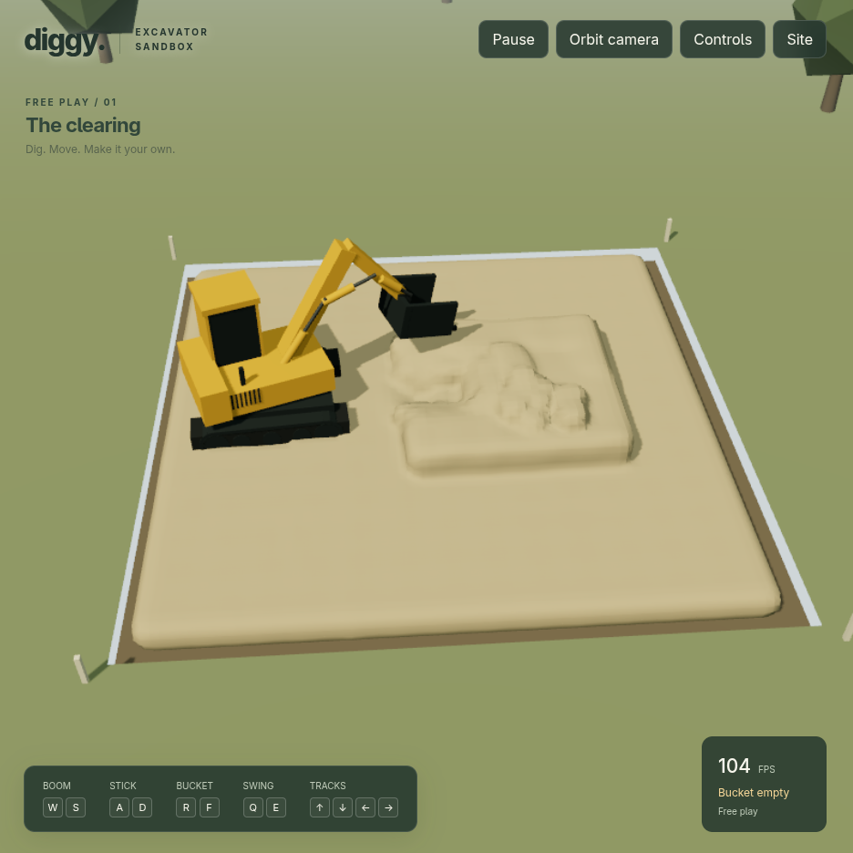

# Diggy · Excavator sandbox



A playable outdoor excavator sandbox with articulated hydraulic controls, tracked movement, GPU volumetric ground, and a continuous material surface. The [material laboratory](http://127.0.0.1:5173/lab.html) remains available for experiments. The soil model is [frozen for now](docs/SIMULATION-BASELINE.md). See [PLAN.md](PLAN.md) and [the first playable checkpoint](docs/PLAYABLE-SIMULATOR.md).

## Run

Requires Node.js 22+ and a browser with WebGPU.

```sh
npm install
npm run dev
```

Open http://127.0.0.1:5173 for the game, or http://127.0.0.1:5173/lab.html for the lab. The game’s Site → Performance panel and the lab header report the actual WebGPU adapter. A software adapter can check correctness but cannot validate integrated-GPU performance. The app requests a low-power adapter; that preference alone does not prove which physical GPU was selected.

### This machine: AMD integrated GPU

Chromium 152 on this Linux installation needed native Vulkan enabled for WebGPU, with OpenGL for ANGLE. Using ANGLE's Vulkan rendering path failed before the application initialized. The following uses a separate temporary browser profile and selects the AMD Vulkan driver without changing desktop settings:

```sh
VK_DRIVER_FILES=/usr/share/vulkan/icd.d/radeon_icd.json chromium \
  --user-data-dir="$(mktemp -d /tmp/diggy-browser.XXXXXX)" \
  --enable-unsafe-webgpu --ignore-gpu-blocklist \
  --ozone-platform=x11 --use-angle=gl --use-vulkan=native --enable-features=Vulkan \
  http://127.0.0.1:5173
```

Only use these experimental browser flags for the local simulator. For measurements, verify that the adapter reports `amd · gcn-5`, rather than SwiftShader or the NVIDIA GPU. Automated measurements additionally record the AMD renderer and PCI device identity.

## Sandbox ground

The game opens on a 12 × 12 m site with a low bed and a raised bank. Operate boom, stick, bucket and swing to excavate, carry and dump material. Arrow keys drive and steer the tracks. Site settings provide dry sand, dry soil and wet dirt, plus a fresh-site reset.

| Action | Keys |
| --- | --- |
| Boom up / down | W / S |
| Stick in / out | A / D |
| Bucket curl / tip | R / F |
| Upper body swing | Q / E |
| Tracks forward / reverse | ↑ / ↓ |
| Tracks steer | ← / → |
| Precise movement | Shift |
| Pause / camera / help | Space / C / H |

The default third-person camera follows behind and above the chassis as it turns. Scroll to zoom. Press C for orbit view, then drag to orbit and right-drag to pan. The first machine uses a reduced-coordinate hydraulic arm and a Rapier chassis. Pitch/roll, full articulated mass transfer, calibrated track compression and mixed/layered game sites remain future work; see the checkpoint for the exact scope.

The map stores volumetric material points, allowing excavated spaces below remaining material. One-metre chunks determine activity. The GPU compacts active and boundary particles, and clears/updates only participating grid nodes. Quiet distant material sleeps without rewriting its mass, composition, or deformation history. A three-dimensional occupancy connectivity check wakes unsupported regions beyond the bucket, while moving samples and lost support wake neighboring chunks.

The terrain uses a fixed 25 cm physics grid, 20 cm material sampling, and 16 cm visual field; laboratory settings remain available separately. This is a smaller development map than the planned 40 × 40 m sandbox, and the active-grid buffers are still densely allocated. Sleeping boundary chunks act as fixed support until awakened. Support connectivity is a conservative occupancy approximation, not a calibrated fracture criterion. See [terrain findings](docs/MILESTONE-4.md) for measured limits.

## Material laboratory experiments

- **Sandbox ground:** chunked volumetric terrain for digging, carrying, and dumping.
- **Pour & settle:** suspended material falls and forms a pile.
- **Stable pile:** a steep volume relaxes until friction arrests motion.
- **Scoop & spill:** use the bucket manually or run the repeatable 15-second scoop/curl/lift/dump cycle.
- **Clump breakup:** compare dry and wet material falling onto the floor.
- **Material mixing:** coarse dry and fine wet inputs retain their own moisture and composition.
- **Undermine:** remove the central support under a soil bridge resting on two piers.

Choose Sand, Soil, or Wet dirt, or adjust continuous moisture, effective grain size, friction, base cohesion, stiffness, viscous resistance, and metal adhesion. Changes reset the scene to make comparisons reproducible. The mixing scenario intentionally uses two fixed input compositions; other mechanical settings still apply.

The default view reconstructs a continuous matte surface from coarse physical samples. Select **Raw points** to inspect the physics directly. **Fine spill grains** toggles optional ballistic detail; sparse physical material remains visible through small shaded volumes tied to the actual physical samples. Neither adds physical mass.

Click the scene to focus keyboard input. `A/D` move along the bed, `W/S` raise/lower, `Q/E` move across the bed, and `R/F` curl/tip. Hold Shift for precise movement. Space pauses. Drag to orbit and scroll to zoom. Inputs can be combined. **Force-limited fixture** is the default: material contact changes bucket momentum and can slow/stall digging or lifting. **Half strength** exposes the load limit. **Prescribed motion** retains the original comparison mode. Release keys to hold position; force limits can prevent a loaded bucket from holding. This fixture is not yet a complete excavator.

## Measurement

“Measure 15 seconds” resets the experiment and records actual frame times, simulation throughput, GPU compute timestamps when available, contact overlap, invalid states, and peak estimated bucket contents. Scoop uses an automatic cycle; undermine removes support after two simulated seconds. Other scenarios evolve under gravity.

Export the last measurement as JSON. The simulation-rate metric must be near 1× as well as FPS near 60; otherwise the physics is falling behind. Time debt is preserved rather than silently dropping required work. Physics step size follows elastic wave-speed and bulk-damping diffusion bounds. Bulk resistance and finer grids require more substeps; the shape-stiffness slider controls shear stiffness independently.

Diagnostics use occasional asynchronous readback. Surface reconstruction and rendering read GPU-resident physical data directly. The surface mesh and draw count stay on the GPU; no mesh readback is needed each frame. The snapshot `volume` field is the initial reference volume. `restVolume` includes permanent compaction; `deformedVolume` also includes recoverable elastic volume change. These are constitutive estimates from material states, not measurements of the rendered surface or air gaps. Diagnostics show permanent compaction, elastic volume change, and estimated stored pressure separately. Bucket volume uses the same geometric containment estimate as bucket mass. Reported memory covers allocated solver buffers and diagnostic buffers, not browser/renderer/driver memory. Bucket mass is a geometric containment estimate, and reaction force and torque feed back into the force-limited fixture. Coupling reads only 32 bytes of GPU metrics per active frame, separately from occasional full material diagnostics. Soil weight is carried by contact, so geometric bucket contents are not added again as a gravity force.

## Verification

```sh
npm run build
npm test
# Start npm run dev in another terminal before browser tests.
VK_DRIVER_FILES=/usr/share/vulkan/icd.d/radeon_icd.json npm run test:browser -- --hardware
VK_DRIVER_FILES=/usr/share/vulkan/icd.d/radeon_icd.json npm run benchmark
VK_DRIVER_FILES=/usr/share/vulkan/icd.d/radeon_icd.json npm run test:materials
VK_DRIVER_FILES=/usr/share/vulkan/icd.d/radeon_icd.json npm run test:rebound
VK_DRIVER_FILES=/usr/share/vulkan/icd.d/radeon_icd.json npm run test:compaction
VK_DRIVER_FILES=/usr/share/vulkan/icd.d/radeon_icd.json npm run test:coupling
VK_DRIVER_FILES=/usr/share/vulkan/icd.d/radeon_icd.json npm run test:terrain
VK_DRIVER_FILES=/usr/share/vulkan/icd.d/radeon_icd.json npm run benchmark:presentation
```

The hardware test advances each material through sustained falling/settling and checks mass and invalid states. It also exercises support removal. The original physics benchmark tests all nine combinations of grid spacing (12.5, 10, and 8 cm) and point budget (4,096, 8,192, and 16,384) with active scoop cycles. `npm run benchmark -- --quick` runs only the default setting. `--headed` runs the measurement in a visible isolated browser window.

`npm run benchmark:presentation -- --quick` measures the current sand/soil/wet scoop settings; `--collapse` measures undermine with automatic support removal. `npm run test:materials` also tests isolated-volume visibility and pressure recovery after granular dilation.

Browser artifacts and screenshots are written to `.local/artifacts/` and ignored by Git. For software verification, use `npm run test:browser` with Chromium's bundled SwiftShader driver if necessary; these timings are not hardware benchmarks.

## Implementation boundaries

- `src/simulation/`: deterministic scenarios, continuous material parameters, bucket pose/collision descriptions.
- `src/physics/`: WebGPU compute, particle/grid transfers, contact and diagnostic readback.
- `src/render/`: Three.js WebGPU rendering and orbit camera.
- `src/diagnostics/`: frame-time statistics.
- `src/main.ts`: UI and simulation scheduling.

The solver uses quadratic B-spline MLS-MPM/APIC transfers, spectral Hencky strain, an experimental pressure-dependent friction/cohesion projection with a tensile cap, pressure-triggered bounded compaction, separate bulk stiffness, damage/dilation history, and compression damping. Coarse sand has no permanent compaction; fine soil starts compacting only above its pressure threshold. Inelastic contacts also resolve APIC motion within a material sample. Atomic grid accumulation uses fixed-point integer mass and momentum because baseline WGSL has no floating-point atomic add. This introduces quantization, especially at low grid mass.

The Three.js shared-storage-buffer bridge is isolated in `src/render/scene.ts` and depends on its backend API. The dependency lockfile pins the tested version; revalidate browser tests when upgrading Three.js.

This is a feasibility prototype, not calibrated geotechnical software. Wetness modifies mechanical behavior; explicit drainage, pore pressure, and separate liquid water are absent. The bucket is kinematic and has no hydraulic force limit or excavator dynamics yet. Material surfaces use GPU density reconstruction with fine matte shading and simulation-driven grain detail. The lab uses a dense grid; sparse world activation belongs to a later milestone.

See [milestone 2 findings](docs/MILESTONE-2.md) for behavior checks, presentation benchmarks, and remaining calibration work.

The standalone optimized 12 m terrain lab prototype measures about 59.8 FPS for sand, soil, and wet dirt at real-time simulation speed on integrated Vega. See [performance revision and validation](docs/PERFORMANCE-REVISION.md).

The coupling proof and its limitations are recorded in [milestone 3](docs/MILESTONE-3.md). The current terrain performance measurements supersede the older frozen laboratory timings; larger-world performance remains unverified.

Run `npm run test:terrain-cache` to compare cached and reference physics. Run `npm run benchmark:presentation -- --terrain --optimization-ab` for the integrated-GPU rendering/cache comparison. Use the hardware environment described above.

`npm run test:game` verifies the playable machine, scoop/lift/swing/dump, track drive/steering, material presets, keyboard input and preserved lab. `npm run benchmark:game` measures the complete scene during keyboard-operated excavation. Both use the hardware browser flags above. The game has its own performance measurements; laboratory FPS is not a game benchmark.

The current complete-game benchmark measures roughly **32–40 FPS** on integrated Vega at adaptive render resolution, with approximately real-time soil simulation. The game has not met the 60 FPS target. See [the game checkpoint](docs/PLAYABLE-SIMULATOR.md) for timings and machine-physics limitations.

`npm run test:driving` checks forward/reverse travel, braking, pivot steering, boundary retreat, loss of traction in midair, moderate pile climbing, steep-slope limits and recovery after either track drops from a ledge. Driving uses contact-limited belt forces instead of passive skid friction. See [driving validation](docs/driving-validation.json).
